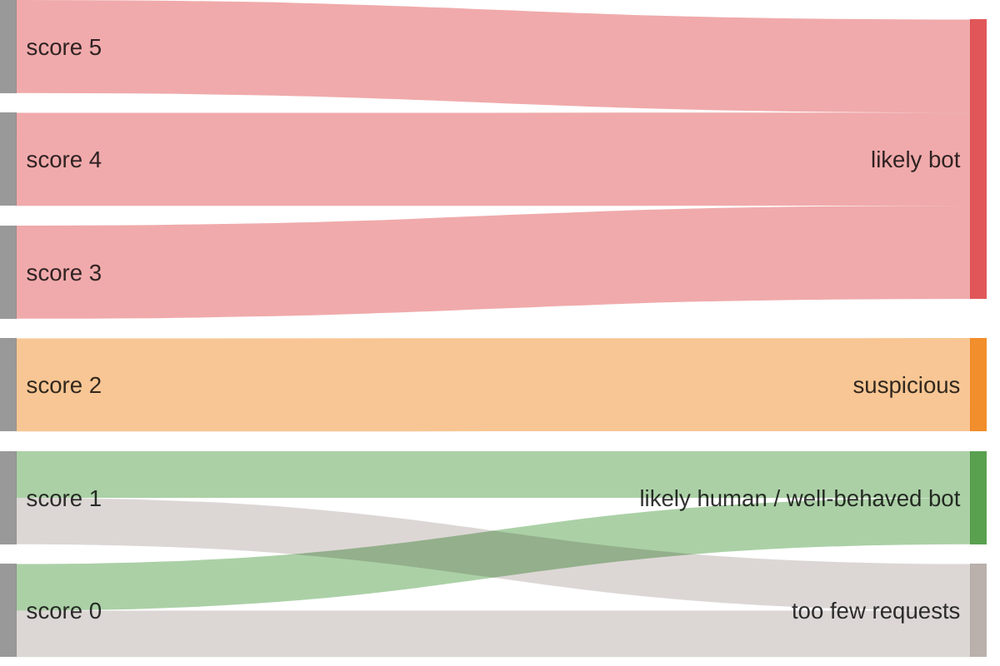

# How the bot score works

Reading from a web access log,  each IP address is granted a 
**score from 0 to 5** and a **label** (*likely bot*, *suspicious*, *too few requests*, *likely human / well-behaved bot*). 

- [1. Labeling the requests](#1-labeling-the-requests)
- [2. The five behaviours](#2-the-five-behaviours)
- [3. "Enough requests"](#3-enough-requests)
- [4. From score to label](#4-from-score-to-label)
- [5. Settings you can change](#5-settings-you-can-change)

## 1. Labeling the requests

The web server handles requests, each of which comes from a computer with an IP address.  
Looking at the requests, a flag is raised on the IP for each of five behaviours.  
The score is the number of flags that were raised.  
As each flag is either absent or present, the score is always a whole number from 0 to 5.

The score is a count of suspicious behaviours, not a probability.  
All behaviours have the same weight.

## 2. The five behaviours

| # | Column | Name | Flag raised when… | Needs enough requests? |
|---|--------|------|-------------|------------------------|
| 1 | `flag_ua` | Suspicious or fake robot name tag | any of the user-agent checks below is true | no |
| 2 | `flag_long` | Absurdly long requests | at least **2** requests have more than **10** query parameters, or a URL longer than **1000** characters | no |
| 3 | `flag_noref` | Never arrives via a link | **no** request has a referrer (empty or `-`) | yes |
| 4 | `flag_slowdown` | Ignores "slow down" | more than **5 %** of its requests got HTTP **429** or **503** | yes |
| 5 | `flag_onething` | Does almost only one thing | more than **80 %** of its requests are the same kind of page (first path segment, e.g. `bitstream`, `search`, `discover`) | yes |

### Flag 1 in detail: the user-agent checks

Flag 1 groups several checks. **Any one of them** is enough to give the point,
and several of them together still give only **one** point.

| Check | True when |
|-------|-----------|
| several crawler names | the IP uses more than one name containing `bot`, `crawl`, `spider` or `slurp` |
| mixed names | some requests carry a crawler name and others do not (e.g. a browser) |
| tool name | the user agent is a scripting library, command-line tool or headless browser (`python-requests`, `curl`, `wget`, `scrapy`, `headlesschrome`, …) or is empty |
| never read robots.txt | at least **50** requests use a crawler name, but `/robots.txt` was never requested |
| DNS failure | only with `--verify-dns`: the IP claims to be Googlebot, Bingbot, Applebot, Yandexbot or Baiduspider, but forward-confirmed reverse DNS does not match |

The `reasons` column of the output CSV lists, in plain language, which checks
and flags were raised for each IP.

## 3. "Enough requests"

An IP needs at least **10 requests** (`--min-requests`) before flags 3, 4 and 5
are counted. Without this rule, an IP that made a single request without a
referrer would look like a bot.

Flags 1 and 2 are counted for any IP, whatever its number of requests.

Consequence: an IP with too few requests can score **at most 2** (flags 1 and
2). A score of 3 or more is only possible for an IP with enough requests.

## 4. From score to label

The label is chosen by checking these conditions **in order**; the first one
that is true wins:

Namely:

| Order | Condition | Label |
|-------|-----------|-------|
| 1 | score ≥ 3 | `likely bot` |
| 2 | score = 2 | `suspicious` |
| 3 | fewer than 10 requests | `too few requests` |
| 4 | otherwise (score 0 or 1) | `likely human / well-behaved bot` |

Reading the table the other way round:

| Score | Possible labels |
|-------|-----------------|
| 0 or 1 | `too few requests` or `likely human / well-behaved bot`, depending on the number of requests |
| 2 | `suspicious` |
| 3, 4 or 5 | `likely bot` |

Reading the diagram:

- **Several scores share one label.** `likely bot` covers scores 3, 4 and 5,
  so three separate links all end up colored red.
- **The score alone does not decide the label.** For scores 0 and 1, the
  number of requests decides whether the link is grey (`too few requests`) or
  green (`likely human / well-behaved bot`).

## 5. Settings you can change

`src/score_bot_ips.py` reads the log and grants the score.	

All thresholds are command-line options of `score_bot_ips.py`:

| Option | Default | Used by |
|--------|---------|---------|
| `--min-requests` | 10 | "enough requests" (flags 3, 4, 5 and the `too few requests` label) |
| `--max-params` | 10 | flag 2: query parameters per request |
| `--max-url-len` | 1000 | flag 2: URL length in characters |
| `--long-min-count` | 2 | flag 2: how many long requests are needed |
| `--slowdown-share` | 0.05 | flag 4: share of 429 / 503 replies |
| `--onething-share` | 0.80 | flag 5: share of requests of one page type |
| `--robots-min-requests` | 50 | flag 1: crawler requests before a missing `robots.txt` read counts |
| `--verify-dns` | off | flag 1: adds the reverse-DNS check |

The score-to-label thresholds (3 and 2) are in the `np.select` call at the end
of `score_ips()`. If you change them, update section 4 to match.
